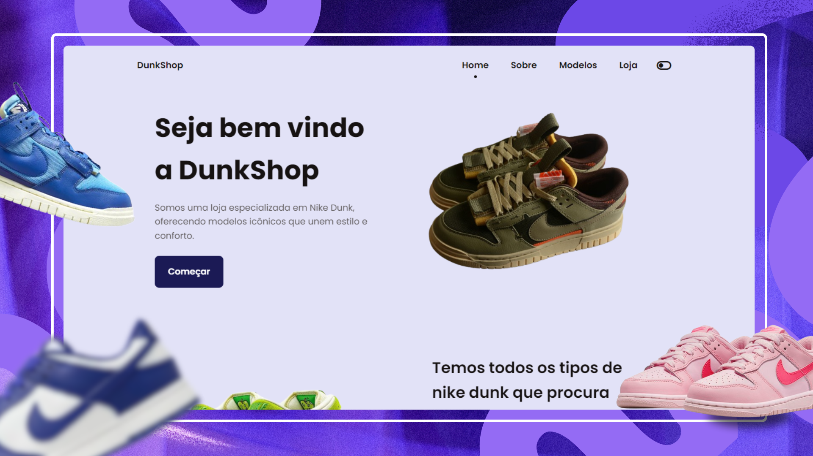
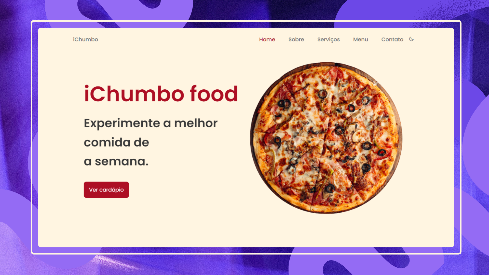
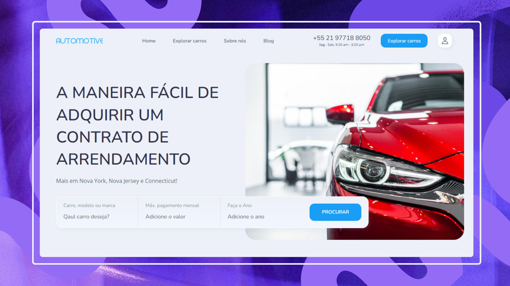
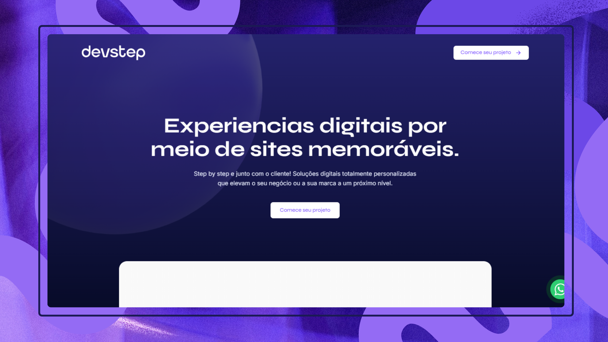
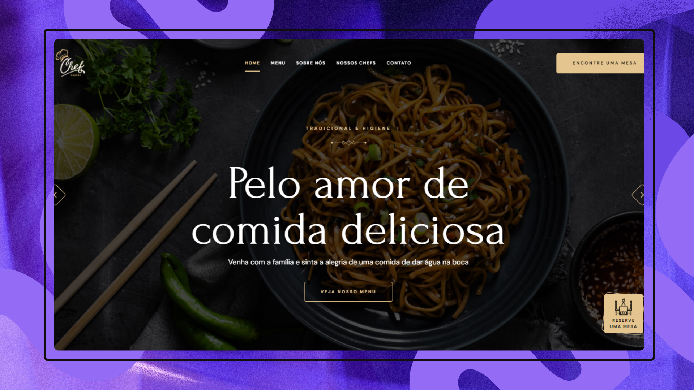
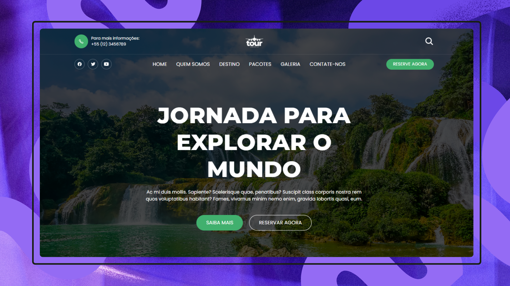

  <a href="https://ichumbo-portfolio.netlify.app/"><strong>PORTFÓLIO ↗</strong></a>
  &nbsp;&nbsp; / &nbsp;&nbsp;
  <a href="https://www.linkedin.com/in/ichumbo/"><strong>LINKEDIN ↗</strong></a>
  &nbsp;&nbsp; / &nbsp;&nbsp;
  <a href="mailto:contato.ichumbo@gmail.com"><strong>E-MAIL ↗</strong></a>
  &nbsp;&nbsp; / &nbsp;&nbsp;
  <a href="https://wa.me/5521977188050"><strong>WHATSAPP ↗</strong></a>

 

01 / SOBRE MIM

<h2>Design na interface. Engenharia em cada detalhe.</h2>

  Sou <strong>Ian Melo</strong>, desenvolvedor <strong>Full Stack & Mobile</strong>
  e fundador da <a href="https://devstep.com.br"><strong>Devstep</strong></a>.
  Desenvolvo aplicações web, aplicativos e e-commerces, combinando
  cuidado visual com a implementação das funcionalidades que sustentam cada produto.

  Atuo da construção de interfaces às APIs, bancos de dados e integrações.
  Meu foco é criar experiências claras para quem usa e código organizado
  para quem dá continuidade ao projeto.

 

02 / TRABALHOS SELECIONADOS

<h2>Da ideia à experiência.</h2>

  Uma seleção de interfaces e projetos que desenvolvi.
  No portfólio, apresento mais detalhes sobre cada trabalho.

  
  

  
  

  
  

  <a href="https://ichumbo-portfolio.netlify.app/"><strong>EXPLORAR PORTFÓLIO ↗</strong></a>

 

03 / PRODUTOS

<h2>Software para o dia a dia.</h2>

  <strong><a href="https://usecofri.com.br">Cofri ↗</a></strong> 
  Gestão financeira para organizar contas, acompanhar despesas e planejar objetivos.

  <strong><a href="https://dragoncorp.com.br">DragonCorp ↗</a></strong> 
  Treinos, avaliações e acompanhamento da evolução de personal trainers e alunos.

  <strong>Reservei</strong> 
  Agendamento e gestão de serviços para simplificar a rotina de profissionais.

  <strong><a href="https://nutrilib.com.br">NutriLib ↗</a></strong> 
  Receitas, categorias e favoritos para facilitar as escolhas do dia a dia.

 

04 / TECNOLOGIAS

<h2>As ferramentas por trás.</h2>

<strong>Web & interfaces</strong>

  
  
  
  
  

<strong>Mobile</strong>

  
  

<strong>Back-end & dados</strong>

  
  
  
  

<strong>CMS & e-commerce</strong>

  WordPress &nbsp; / &nbsp; Elementor &nbsp; / &nbsp; OpenCart &nbsp; / &nbsp; Magento

 

05 / CONTATO

<h2>Vamos construir algo juntos? ↗</h2>

  Tenho interesse em oportunidades como desenvolvedor Full Stack & Mobile,
  colaboração com equipes e desenvolvimento de produtos digitais.

  <a href="mailto:contato.ichumbo@gmail.com"><strong>contato.ichumbo@gmail.com</strong></a>
  &nbsp; · &nbsp;
  <a href="https://www.linkedin.com/in/ichumbo/">LinkedIn ↗</a>

 

  CODE BY IAN &nbsp; / &nbsp; RIO DE JANEIRO, BRASIL

